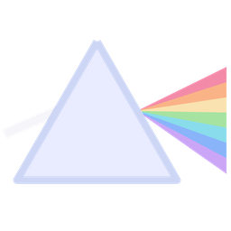

<p align="right"><sub><b>English</b> · <a href="README.md">Español</a></sub></p>

<p align="center"></p>

# prisma · image2png

Turns **any image into a PNG** from the console. A single ~800 KB `.exe`, with no
dependencies and no installation, written in C17 and built with clang (LTO, SSE4 + AVX2 picked at
startup). It reads 13 formats with its own decoders and everything else through Windows'
codecs; it writes the smallest PNG it can without losing a single bit.

And above all: **it understands transparency however it comes** — alpha channel, color key, palette
with alpha, 1-bit mask, premultiplied color, color matted over white, AVIF/HEIC auxiliary
image — and delivers it as straight, exact alpha. It can also create it, clean it up or remove it.

```
image2png foto.heic                          foto.png
image2png -r fotos -o png --keep-tree        a whole folder, in parallel, with subfolders
image2png logo.jpg --remove-bg               background out, soft edges and no halo
image2png animacion.gif                      APNG with 8-bit transparency
image2png icono.png --colors 64              PNG8 with soft alpha: a fraction of the size
```

The 88 options, grouped: `image2png --help`. Recipes: `image2png --examples`. What an
image has (alpha, colors, profile and the best possible PNG) without converting it: `image2png -i archivo`.

`prisma` is the suite; `image2png` is its first tool. The build and the modules (`src/core`,
`src/codec`, `src/png`, `src/ops`) are designed so that other `*2png` tools can share
the whole engine.

---

## What it reads

| format | decoder | what it knows about transparency |
|---|---|---|
| PNG / APNG | own | all 15 color type and depth combinations, Adam7, gray/RGB/palette `tRNS`, APNG compositing with real disposal and Porter-Duff blending, broken CRC with `--ignore-crc`, salvaging truncated files |
| GIF 87a/89a | own | transparent index, the 4 disposal modes, interlacing, delays the way browsers handle them |
| BMP / DIB | own | OS/2 and V1–V5, `BITFIELDS`/`ALPHABITFIELDS`, RLE4/RLE8 with skips (they stay transparent), 32 bits with the 4th byte at zero = opaque |
| ICO / CUR | own | every size, DIB or PNG inside, AND mask, "inverse" pixels, cursor hotspot |
| TGA | own | RLE, palettes, 4 origins, 2.0 footer: useful alpha, alpha to keep or **premultiplied** |
| PSD / PSB | own | 1/8/16/32-bit composite, RGB/CMYK/Lab/gray/palette, **removes the white matte** from the composite |
| DDS | own | BC1–BC7, BC6H (HDR), DXT2/4 and **premultiplied** mode (8, 16 bits and float), 25+ DXGI formats |
| QOI, PNM/PAM/PFM, farbfeld, SGI, PCX, Radiance HDR | own | PAM with alpha, 16-bit RGBA farbfeld, RLE RGBA SGI, RGBA PCX, HDR/PFM with tonemap |
| JPEG, TIFF, JPEG XR, WebP, JPEG XL, RAW/DNG | Windows codecs (WIC) | TIFF with associated and unassociated alpha, CMYK with a profile |
| **HEIC / AVIF** | WIC + own ISOBMFF reader | **auxiliary alpha recovered** (Windows ignores it), premultiplied color (`prem`), corrected YCbCr matrix, primaries in `cICP` |

The format is decided by the **content**, not by the extension (a `.png` that's really a
JPEG is read just the same). What can't be read fails with a clear message: JPEG 2000, OpenEXR, PDF,
XCF, ICNS, WMF/EMF, or a WebP/HEIC/AVIF/JPEG XL without the Microsoft Store codec installed (it says
which one to install). `image2png --formats` lists what your computer has.

---

## Transparency: what sets it apart

**When reading**, each format brings its own trap, and each one is solved:

- **Premultiplied** (TGA 2.0, DDS, DXT2/4, AVIF with `prem`) → divided with exact integer
  rounding; in floating point, in linear light and *before* the tonemap. Premultiplied formats that
  come through WIC (PBGRA) are converted by the codec itself.
- **Matted** (the PSD composite is blended with white) → it's un-blended: `c = (c − (1−a)·m) / a`.
- **Alpha that isn't alpha** (32-bit BMP/TGA with the 4th byte at zero, unused attribute bit
  in 16-bit TGA) → opaque, with a warning.
- **Masks** (ICO's AND, RLE skips in BMP, GIF's transparent index, `tRNS`) → 8-bit
  alpha without halos.
- **AVIF/HEIC**: Windows' codec drops the alpha, which travels as an auxiliary image. prisma reads
  the ISOBMFF boxes, builds a copy of the file where the alpha is the main image, decodes it
  with the same codec (depth, range and tiles included), aligns it with each item's `irot`/`imir`
  rotations and pastes it in. Result: alpha identical to libavif's.
- **Animations** (GIF, APNG) → real Porter-Duff compositing over a translucent canvas (Pillow, for
  example, composites wrongly when the destination is already semi-transparent).

**When processing**, 31 of the 88 options are about transparency (the per-pixel ones are
fused into a single pass over memory):

| option | what it does |
|---|---|
| `--remove-bg [color]` | erases the background **connected to the border** (scanline fill, O(n)) and un-blends a band on both sides of the boundary: it estimates the subject's pure color by propagating the interior with BFS and splits each edge pixel into subject + background. The antialiasing stays soft and fringe-free, and enclosed white (someone's eyes, the hole of a letter) isn't touched |
| `--color-to-alpha color` | the GIMP/GEGL algorithm: the minimum alpha that explains each pixel as a blend with that color; it keeps shadows and antialiasing |
| `--key color --fuzz % --feather %` | color key with tolerance and a soft ramp |
| `--unmatte color`, `--unpremultiply`, `--premultiply` | repair or produce matte and premultiplied alpha |
| `--defringe N`, `--bleed`, `--clean` | remove fringes; extend color under alpha 0 (halo-free textures in mipmaps); normalize what's invisible |
| `--mask img`, `--alpha-from luma\|inverse-luma\|r\|g\|b`, `--extract-alpha`, `--invert-alpha` | the alpha from another image or a channel, or the alpha as an image |
| `--threshold`, `--alpha-levels`, `--opacity` | binary alpha, levels with gamma, global opacity |
| `--flatten color [--linear]`, `--alpha remove` | composite over a background, optionally in linear light |
| `--resize … [--linear]` | rescales **premultiplied** (no dark halos on the edges), 7 filters, optionally in linear light |
| `--trim`, `--pad`, `--crop`, `--rotate`, `--flip` | the geometry: in animations the crop is the union of all frames |
| `--colors N` | an N-color palette **with alpha**: see below |

**`--colors N`, alpha-aware quantization.** Two colors with alpha are compared the way they'd look
over black and over white (the average of both errors, premultiplied and weighted per channel).
That metric is a positive-definite quadratic form, so k-means minimizes it exactly:
median cut with a priority queue and minimum-variance cut, Lloyd until convergence with a pruned
nearest-neighbor search, reseeding of empty centers, and direct remapping, serpentine Floyd-Steinberg
or Bayer 8×8. Measured: **0.99×** the cost of an 8-seed, 300-iteration k-means++,
and dithering lowers the error of the local average color by 11 %.

---

## The PNG it writes

- **Minimum lossless color type and depth**: palette with `tRNS` (translucent entries first),
  1/2/4-bit gray, color key in `tRNS`, 16 bits only if they're really used.
- **Per-row filters** (`none`, `sub`, `up`, `avg`, `paeth`, `minsum`, `entropy`, `bigrams` or
  `brute`: whichever really compresses best), picked in parallel. At the default level, a
  **race over a sample** of the image picks the strategy: none of them always wins (measured:
  `minsum`, libpng's heuristic, loses 20–27 % on flat graphics; `none` loses 40–60 % on
  photos). In 16 bits the same race decides the deflate level: on the noise of the low byte,
  libdeflate's level 1 beats level 9 by ~4 %.
- **libdeflate's deflate in parallel chunks** (pigz's technique, with a minimal patch
  documented in [`third_party/libdeflate/PATCHES.md`](third_party/libdeflate/PATCHES.md)).
- **Levels** `-O0` (`--fast`) to `-O4` (`--max`: tries everything).
- **Color**: ICC profile → `iCCP` (and if the profile is sRGB, the 13-byte `sRGB` chunk); CICP
  codes → the **`cICP`** chunk of PNG's 3rd edition (Display P3, BT.2020, HDR); `--icc srgb` converts the
  pixels (ICC profile with Windows' color engine; CICP in linear light with Bradford
  adaptation).
- **Metadata** of your choice (`--meta none|color|all`): EXIF (with the orientation already applied), XMP,
  UTF-8 text, DPI.
- **Atomic writes** (temporary file + replace), long and Unicode paths.

---

## Performance

Median of 3 runs on an i7-1165G7 (4 cores / 8 threads), the full job (read, decode,
encode, write) and every output verified lossless before measuring. Full details and
conditions in [`docs/benchmarks.en.md`](docs/benchmarks.en.md).

| case | **prisma** | Pillow | Pillow `optimize` | OpenCV level 9 | ffmpeg |
|---|---|---|---|---|---|
| 3840×2400 JPEG photo | **843 ms · 2,231 KB** | 1,242 ms · 2,367 KB | 3,732 ms · 2,140 KB | 15.6 s · 2,254 KB | 1,265 ms · 2,487 KB |
| 3840×2400 photo with alpha | **1.35 s · 3,410 KB** | 1.84 s · 3,644 KB | 7.49 s · 3,280 KB | 26.6 s · 3,439 KB | 1.76 s · 3,810 KB |
| 16 bits 2048×1536 | **550 ms · 12.4 MB** | loses the 16 bits | loses the 16 bits | 3.53 s · 12.9 MB | 1.51 s · 12.4 MB |
| 72-frame GIF → APNG | **474 ms · 113 KB** | 1,019 ms · 235 KB | — | — | 1,452 ms · 236 KB |
| folder of 24 screenshots | **508 ms · 2,509 KB** | 1,270 ms · 2,700 KB | 3,718 ms · 2,644 KB | 6.17 s · 2,594 KB | 5.20 s · 2,795 KB |
| 1920×1080 screenshot | 215 ms · **107 KB** | 101 ms · 117 KB | 276 ms · 115 KB | 404 ms · 114 KB | 363 ms · 126 KB |
| 1024×1024 logo with alpha | 197 ms · **69 KB** | 71 ms · 85 KB | 160 ms · 83 KB | 324 ms · 86 KB | 387 ms · 92 KB |

How to read it:

- prisma is a **command line**: on every run it pays for creating the process, which on this machine
  costs 200–400 ms (this machine's antivirus injects into every new process: `cmd /c exit` takes
  a median of 419 ms). Pillow and OpenCV run inside the same Python and don't pay it; that's why on a single small
  image Pillow is faster, and on a folder —a single process, files in
  parallel— prisma is 2.5× faster than Pillow and leaves everything smaller.
- On photos, Pillow `optimize` leaves the PNG 4 % smaller than prisma's default level at
  4–5.5× the time; `prisma --max` beats everyone (1,975 KB on the JPEG photo) in exchange for ~1 minute.
- With `--fast` the 4K JPEG photo goes through in 345 ms.

---

## How it's tested

| layer | what | result |
|---|---|---|
| end-to-end suite (`tests/suite.py`) | 236 cases: each one builds its input, runs the real `.exe` and compares against an exact oracle (the image it was generated from) or against an independent decoder (Pillow, OpenCV, our own PNG/APNG reader written from the specification) | 236/236 |
| the same suite under **AddressSanitizer** | `build.ps1 -Mode asan`: in that build the slack of every memory block is poisoned, so a byte read past the end blows up | 236/236, 0 reports |
| C unit tests (`tests/unit`) | **exhaustive** integer conversions, the algebra of the D4 group, CICP matrices against the standard, chunked deflate, SIMD filters against the scalar definition, UTF-8, and the ISOBMFF reader against **all** of its truncations + 20,000 corruptions | 20/20, 133,056 checks |
| mutation fuzzing (`tests/fuzz.py`) | truncating, flipping bits, "interesting" words, duplicated or deleted blocks, PNG CRCs repaired to get deeper; with random operations to exercise the whole pipeline; automatic bisection of any crash | **22,000 mutants, 0 findings** (16,000 with the slack poisoned) |
| benchmarks (`tests/bench.py`) | against Pillow, OpenCV and ffmpeg, verifying that every output is lossless before measuring | [`docs/benchmarks.en.md`](docs/benchmarks.en.md) |

```
python tests/suite.py -j 6                      full suite
build\release\unit.exe                          unit tests
python tests/fuzz.py -n 5000                    fuzzing (uses build\asan\image2png.exe)
python tests/bench.py                           benchmarks (rewrites docs/benchmarks.md)
```

The tests need Python 3.10+ with `numpy`, `Pillow` (with AVIF) and `opencv-python`; the benchmarks also use `ffmpeg` if it's on the PATH.

---

## Building

Requirements: Windows 10/11 x64 and **Visual Studio 2022** with *Desktop development with C++* and
the *C++ Clang tools for Windows* component, and PowerShell 7 (it builds every source in parallel).

```
.\build.ps1                      release (LTO) -> bin\image2png.exe
.\build.ps1 -Mode dev            unoptimized, with symbols -> build\dev\
.\build.ps1 -Mode asan           AddressSanitizer -> build\asan\ (with its runtime next to it)
.\build.ps1 -Tools unit          unit tests -> build\release\unit.exe
.\build.ps1 -Check               compile only: a quick check of types and warnings
```

The `vcvars64` environment is cached (`build\vcvars-env.json`): the build doesn't pay its 3 seconds
every time. For ASan the MSVC toolset's runtime is used, because the LLVM 19 one that Visual
Studio ships can't intercept Windows 11 24H2's functions and crashes on startup.

---

## Design

```
 files ──► inputs (wildcards, -r, stdin) ──► thread pool: one job per file (LPT)
                                                          │
   read (mmap ≥ 64 MB) ──► decode ──────────────────────► │  signature → own decoder
                            │ 13 own, SIMD                │  otherwise → WIC (+ heif.c: alpha and color)
                            ▼                             │
   pipeline (16 stages, fixed order; the per-pixel ones fused into a single pass)
                            ▼
   analyze (unique colors, alpha, gray, 16→8) ─► color type plan ─► pack
                            ▼
   filter per row (parallel, AVX2) ─► deflate in parallel chunks ─► atomic write
```

| module | responsibility |
|---|---|
| `src/core` | aligned memory (with an ASan mode), work-sharing thread pool, files (long paths, atomic writes), UTF-8 text, terminal, CPU, color space, CICP, ICC |
| `src/codec` | own decoders, WIC, ISOBMFF reader (`heif.c`), zlib on top of libdeflate, BCn, EXIF, animation compositing |
| `src/ops` | the operations: fused pixelops, D4 geometry, resize, background, BFS propagation, quantization, pipeline |
| `src/png` | analysis, plan, packing, filters, chunk writing, encoder |
| `src/app` | declarative CLI (one table of options), inputs, interface components |
| `src/tools/image2png` | the tool: configuration, jobs, output names, report |

Decisions that cut across everything:

- **A single internal representation**: RGBA with straight alpha, 8 or 16 bits. Each operation is
  written once; the encoder then reduces to what the image really uses.
- **SIMD multiversioning**: the hot kernels are written once as an inline template and
  instantiated for SSE4 and AVX2; dispatch is decided at startup, not per pixel.
- **Complexity declared** in the header of every non-trivial function; nothing quadratic where the
  file decides the size.
- **Errors**: the first one wins (it explains the cause), warnings are deduplicated, a broken file never
  takes the batch down (structured exceptions per job).

---

## Known limits

What it does **not** do today, said plainly:

- **Formats**: JPEG 2000, OpenEXR, SVG, PDF, XCF and ICNS aren't read (the error says so). PSD: only
  the composite, not the layers. The output is always PNG/APNG.
- **Windows codecs**: whatever goes through WIC depends on what's installed. HEIC/AVIF/WebP/JPEG XL need
  the Microsoft Store extensions.
- **AVIF/HEIC through WIC**:
  - the codec delivers 8 bits even if the AVIF is 10 or 12;
  - an AVIF with an identity matrix (lossless RGB), YCgCo or constant luminance can't be
    decoded properly with Windows' codec: prisma warns about it;
  - a very saturated color that the codec clipped when converting from YCbCr doesn't come back exact (the rest
    stays at the floor of differences with libavif: ±4 levels);
  - the matrix correction is measured and tested for AV1; in HEIC the color stays the way the codec
    delivers it (there's no HEVC encoder to test it with);
  - animated AVIF (`avis`): the first frame is read;
  - HDR (PQ/HLG): it's mapped from the codec's floating-point output; `--icc srgb` doesn't convert HDR CICP.
- **Animated WebP**: depends on Windows' codec (not covered by the tests).

---

## License

MIT (see [`LICENSE`](LICENSE)). libdeflate, included in `third_party/libdeflate`, is by Eric Biggers
and also MIT ([`COPYING`](third_party/libdeflate/COPYING)); its changes are in
[`PATCHES.md`](third_party/libdeflate/PATCHES.md).

<!-- i18n source=README.md sha256=09dca14a6e7c -->
